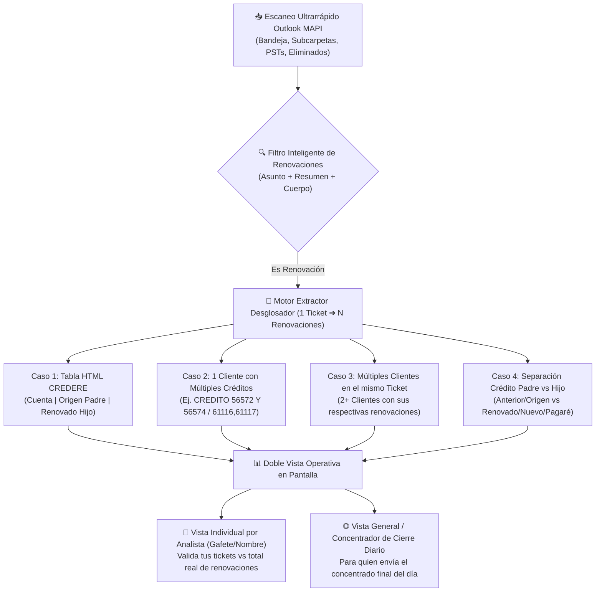

# 📋 Plan de Trabajo: Sistema Validador y Concentrador Diario de Renovaciones FONACOT

**Carpeta del Proyecto:** `C:\Users\sammy.avila\.gemini\antigravity\scratch\FonacotValidadorRenovaciones`  
**Objetivo Principal:** Garantizar que **ninguna solicitud de cancelación de renovación** (individual o múltiple) se quede sin cancelar en el día de su autorización ni antes del cierre mensual, desglosando cada renovación individual por **Número de Cliente**, **Crédito Renovado (Hijo / Nuevo)** y **Crédito Origen (Padre / Anterior)**.

---

## 1. 🔍 Diagnóstico del Problema Real (Basado en los Correos Analizados)

Al analizar los correos reales de iTop (`I-361515`, `I-359504`, `I-359592`, `I-359442`, `I-359489`, `I-359527`, `I-359736`, etc.), identificamos por qué ocurren omisiones humanas como la del 30 de septiembre:

1. **Un solo ticket puede contener múltiples renovaciones ocultas:**
   - **Caso A — Un Cliente con varios Créditos Renovados en el Resumen o Cuerpo (`I-359504`, `I-359442`, `I-359592`, `I-359489`):**
     - Ejemplo real (`I-359504` de Nancy): El resumen dice `CANCELACION DE RENOVACION CLIENTE 5864479 CREDITO 56572 Y 56574`, pero abajo en la tabla de descripción solo pusieron `Número de Cliente: 5864479` sin repetir los dos créditos. Al revisarlo rápido, el analista ve 1 ticket y 1 cliente, y solo manda cancelar uno de los dos créditos.
     - Ejemplo real (`I-359592`): `Número de Cliente: 3386153 | Número de Crédito (renovación): 61116, 61117, 61118` (1 ticket = **3 renovaciones**).
     - Ejemplo real (`I-359388` / `I-359346`): Separados por guion o conjunción: `48736 - 48735` o `45878 y 45880`.
   - **Caso B — Un Ticket con Múltiples Clientes y Múltiples Renovaciones en Tabla (`I-361515`, `I-359546`, `I-359364`):**
     - Ejemplo real (`I-361515` de Sammy): Viene como `Análisis | cancelación renovaciones` e incluye una tabla HTML con **9 clientes distintos**, cada uno con su columna `Cuenta` (Cliente), `Operación (Origen)` (Crédito Padre) y `Renovado` (Crédito Hijo). (1 ticket = **9 renovaciones**).
   - **Caso C — Múltiples Clientes en Texto Libre dentro del mismo Ticket:**
     - Cuando una sucursal envía en un mismo correo 2 o más trabajadores distintos con sus respectivos números de cliente y números de crédito/renovación.
   - **Caso D — Confusión entre Crédito Padre (Origen / Anterior) y Crédito Hijo (Renovado / Nuevo / Pagaré):**
     - Ejemplo real (`I-359527`): `CLIENTE: 6173151 CREDITO ANTERIOR: 34232 CREDITO NUEVO: 57137`.
     - Ejemplo real (`I-359736`): `Cliente: 4919283 | Ya renovado: 71470 (favor de cancelar este) | Antes de renovar: 81106`.
     - Ejemplo real (`I-362259`): `cancelar la renovación del crédito 9291 con no. de pagaré 91258, del cliente con no. Fonacot 4530500`.

2. **Los tickets de renovación llegan con muchos títulos distintos:**
   - Algunos dicen explícitamente `CANCELACION DE RENOVACION`, pero otros llegan con el resumen:
     - `CANCELACION DE CREDITO` / `CANCELAR CREDITO`
     - `eventual` (como `I-359489`, donde solo en el cuerpo dice *"cancelación de la renovación siguiente"*)
     - `APOYO` (como `I-359486`, donde en el cuerpo menciona *"No liberó crédito / Número de Crédito/renovación"*)
     - `Análisis | cancelación renovaciones` (concentrados de CREDERE)
     - Menciones a `no disponible`, `no liberó disponible`, `topado por buró`, `bajó capacidad al 10% / 15%`, `reversa a la renovación`, `crédito padre / hijo`.

---

## 2. 🏗️ Arquitectura de la Nueva Herramienta (`FonacotValidadorRenovaciones`)

Se creará una aplicación independiente en `C:\Users\sammy.avila\.gemini\antigravity\scratch\FonacotValidadorRenovaciones`, reutilizando el motor ultrarrápido de conexión a Outlook MAPI (multi-buzón, PSTs, subcarpetas, elementos eliminados, regla de Nancy `2609` y detección de reasignaciones) de la versión 4.3, pero **especializada al 100% en Auditoría, Desglose y Concentrado Diario de Renovaciones**.

---

## 3. 🧠 Componentes Técnicos que se Desarrollarán

### Módulo 1: Detector Especializado de Correos de Renovación (`renovacion_parser.py`)
Un clasificador y filtro de alta sensibilidad que identifica **todos** los tickets de cancelación de renovación aunque el título venga disfrazado (`CANCELAR CREDITO`, `APOYO`, `EVENTUAL`, etc.), buscando en **Asunto, Resumen y Descripción**:
- **Palabras clave primarias:** `renovación`, `renovacion`, `renovaciones`, `renovado`, `renovar`, `reversa a la renovación`, `REN `.
- **Palabras clave combinadas (cuando el título dice "Cancelación de crédito" o "Apoyo"):** `no liberó disponible`, `no da disponible`, `capacidad de descuento`, `topado por buró`, `crédito padre`, `crédito hijo`, `operación (origen)`, `crédito anterior`, `crédito nuevo`, `seguimiento a la cancelación en credere`.
- **Exclusión de falsos positivos:** Ignora tickets que mencionan la palabra "renovación" solo para otros trámites (ej. *"corrección de domicilio/nombre en pagaré"*, *"cambio de bandera eventual/indeterminado para poder renovar"*, *"error al renovar"* donde aún no existe crédito renovado a cancelar, o los separa en una categoría informativa de *"Incidencia para renovar (No es cancelación)"* para no contaminar el lote de cancelaciones).

### Módulo 2: Desglosador "1 Ticket ➔ N Filas de Renovación" (Anti-Omisiones)
Esta es la pieza central para que nunca vuelva a pasar lo del 30 de septiembre:
- **Regla de Oro:** **En la tabla principal, cada fila representa 1 RENOVACIÓN A CANCELAR (no solo 1 ticket).**
- Si el ticket `I-359504` tiene el cliente `5864479` con los créditos `56572 Y 56574`, el sistema genera **2 filas independientes** vinculadas al mismo ticket `I-359504`:
  - Fila 1: `I-359504` | Cliente: `5864479` | Crédito Renovado (Cancelar): `56572` | Alerta: `🚨 MULTI-RENOVACIÓN (1 de 2 en este ticket)`
  - Fila 2: `I-359504` | Cliente: `5864479` | Crédito Renovado (Cancelar): `56574` | Alerta: `🚨 MULTI-RENOVACIÓN (2 de 2 en este ticket)`
- Si el ticket `I-361515` trae una tabla de 9 renglones, el sistema genera **9 filas independientes** (`1 de 9` ... `9 de 9`), extrayendo de cada renglón:
  - `No. Cliente (Cuenta)`
  - `Crédito Padre (Operación / Origen / Anterior)`
  - `Crédito Hijo / Renovado (El que se cancela)`
  - `Sucursal` y `Fecha de operación`
- **Cruce de Resumen + Descripción:** Siempre combina los números encontrados en el **Resumen** y en la **Descripción** (así, aunque en la descripción solo hayan puesto el Cliente `5864479` como en el caso de Nancy, toma los créditos `56572` y `56574` del Resumen).
- **Alerta de Datos Incompletos (`⚠️ FALTA CRÉDITO O CLIENTE`):** Si un correo pide cancelar una renovación pero el usuario olvidó escribir el número de cliente o el número de crédito renovado (como `I-359334` o `I-359385`), lo marca en **ROJO** como `❌ DATO FALTANTE (Revisar correo)` para solicitarlo de inmediato antes de las 14:00 hrs / cierre.

### Módulo 3: Dos Modos de Operación (Individual y Concentrador General de Fin de Día)

1. **👤 Modo Validación por Compañero (Filtro por Gafete o Nombre):**
   - Cada analista (Nancy `2609`, Sammy `7353`, María `7341`, Citlali `7799`, Javier `6978`, etc.) puede consultar en 2 segundos:
     - **Cuántos Tickets de renovación** tiene asignados hoy.
     - **Cuántas Renovaciones Reales (Créditos a cancelar)** suman esos tickets (ej. *"Tienes 5 tickets asignados, pero contienen **14 renovaciones** en total"*).
     - Cuáles tickets traen **2 o más renovaciones** resaltados con alerta visual para que verifique que metió todas.
   - Respeta la **Regla de Nancy (`2609`)** (solo le cuenta las que ella atendió y no reasignó) y la **Detección de Reasignaciones entre compañeros**.

2. **🌐 Modo Concentrador General (Para quien envía la relación final del día):**
   - Al dejar el filtro de gafete vacío (o elegir *"🌐 Concentrado General del Día"*), junta **absolutamente todas las renovaciones del día de todos los compañeros** (sin duplicar el correo inicial de Nancy con el del compañero asignado).
   - **Deduplicación Inteligente por `(No. Cliente + No. Crédito Renovado)`:** Si una sucursal mandó 2 tickets distintos por el mismo cliente y mismo crédito renovado (como pasó el 29/09 con `I-359387` e `I-359388` del cliente `3160029` donde el segundo corregía `48736 - 48735`), el sistema avisa que ese cliente tiene múltiples tickets y consolida la lista limpia.
   - **Checklist interactivo de validación (`☑️ Validado / Enviado a Cancelar`):** Permite ir marcando con palomita cada renovación conforme se captura o se revisa en el lote final, mostrando un contador en vivo: `Pendientes de validar: X de Y`.
   - **Alerta de Cierre de Mes / Horario Crítico:** Destaca visualmente si es fin de mes o si hay renovaciones con fecha de días anteriores que requieren atención crítica.

### Módulo 4: Exportación Especializada a Excel y Tabla Copiable para Correo
1. **Excel Ejecutivo Multi-Hoja (`.xlsx`):**
   - **Hoja 1 (`Desglose_Renovaciones_Cancelar`):** 1 fila por cada renovación individual (`Ticket iTop con hipervínculo`, `Fecha/Hora`, `Gafete`, `Agente Responsable`, `No. Cliente`, `Crédito Renovado (Hijo)`, `Crédito Origen (Padre)`, `Tipo de Caso (Individual / Múltiple / Tabla)`, `Motivo / Sucursal`, `Estado de Validación`).
   - **Hoja 2 (`Resumen_Por_Ticket_y_Agente`):** Muestra cuántos tickets recibió cada compañero vs cuántas renovaciones reales contenían.
   - **Hoja 3 (`Alertas_Multiples_y_Faltantes`):** Filtra exclusivamente los tickets peligrosos (los que traían 2+ clientes, 2+ créditos, o datos incompletos) para doble revisión antes del cierre.
2. **Botón `📋 Copiar Tabla Concentrada al Portapapeles`:**
   - Copia directamente la relación limpia de `Cliente | Crédito Origen (Padre) | Crédito Renovado (Hijo) | Ticket | Agente` lista para pegarse en un correo de Outlook o en un Excel de control al final del día.

---

## 4. 📁 Estructura de Archivos en la Nueva Carpeta

Crearemos la carpeta `C:\Users\sammy.avila\.gemini\antigravity\scratch\FonacotValidadorRenovaciones` con la siguiente estructura modular:

- `core_renovaciones.py`: Motor de expresiones regulares y parser HTML para detectar renovaciones, separar `Crédito Padre (Origen)` vs `Crédito Hijo (Renovado)`, extraer tablas (`I-361515`) y desglosar múltiples clientes/créditos (`I-359504`, `I-359592`).
- `outlook_renovaciones_engine.py`: Motor MAPI ultrarrápido (con `win32timezone` integrado, soporte multi-buzón/PST, subcarpetas, eliminados, regla de Nancy `2609`, deduplicación entre compañeros y exportador a Excel con links a iTop).
- `validador_renovaciones_app.py`: Interfaz gráfica moderna (CustomTkinter) con KPIs dobles (*Tickets de Renovación* vs *Total Créditos a Cancelar*), alertas en color para tickets con múltiples renovaciones, filtro por compañero o concentrado general, y checklist de validación.
- ` pruebas_casos_reales.py`: Script de verificación automática contra los correos `.eml` reales (`I-361515` con 9 renovaciones, `I-359504` con 2 renovaciones de Nancy, y el historial de Outlook del 30 de septiembre y octubre).
- `ValidadorRenovaciones_v1.spec`: Configuración lista para compilar el `.exe` y su carpeta `.zip`.

---

## 5. ✅ Plan de Ejecución Paso a Paso

1. **Paso 1:** Crear los módulos base en `C:\Users\sammy.avila\.gemini\antigravity\scratch\FonacotValidadorRenovaciones` (`core_renovaciones.py` y `outlook_renovaciones_engine.py`).
2. **Paso 2:** Probar el motor de extracción directamente contra los dos archivos `.eml` que compartiste (`I-361515` e `I-359504`) y contra los correos del 30 de septiembre en tu Outlook para verificar que detecte el 100% de los clientes y créditos renovados sin omitir ninguno.
3. **Paso 3:** Construir la interfaz gráfica `validador_renovaciones_app.py` con vista individual por agente, vista concentradora general de cierre diario, alertas de múltiples renovaciones y exportación a Excel / Portapapeles.
4. **Paso 4:** Compilar el ejecutable standalone/carpeta y generar el paquete `.zip` listo para distribuir.
